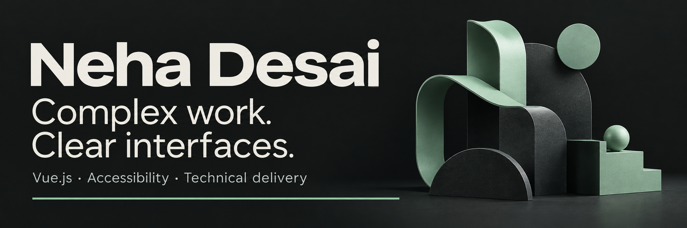

**I work where product decisions meet the interface.**

I’m a frontend engineer with **8+ years of experience**, strongest in **Vue.js 2/3 and JavaScript**. I like making a complicated workflow easier to understand, use and maintain, then helping the team get it into people’s hands.

[Explore my portfolio](https://neha-desai.de5.net/) · [LinkedIn](https://www.linkedin.com/in/neha-d-763481101) · [Let’s talk](mailto:nehadesai924117@gmail.com)

## The work behind the interface

At **Cognizant**, I’m a **Sr Software Associate** on the **Apple client account**. Previously, I was a **Sr Analyst at Capgemini** on the **GE Aviation client account**.

| Work | What I brought to it |
| :--- | :--- |
| **Core · Advisor support** | Vue 3 feature delivery, UI improvements informed by Radar reports, API contracts and cross-functional coordination. |
| **VIMS & DMS · Facilities intelligence** | Frontend architecture, reusable patterns and delivery governance; a **40% improvement in sprint velocity** on the workstream. |
| **Columba · Apple TV application** | Taking UX wireframes into reusable components and coordinating the design-to-engineering handoff. |
| **GE Aviation · Manufacturing workflows** | Frontend components and integrations; **15% lower initial load times** through lazy loading, compression and caching. |

I care about accessible interactions, clear API boundaries and code people can build on. My [professional case studies](https://neha-desai.de5.net/#work) describe my contribution without exposing confidential client code or screens.

## Personal projects you can explore

### [Fitkin](https://github.com/neha-pd/caloriesTracker)

**Food, movement and the small habits that add up.**

An Expo and React Native project that brings meal logging, routines and progress together, with a companion called Kin. It includes offline food search, optional online chat and device-dependent health integrations.

There’s a web preview and an Android release. It’s an early personal project, with real room for feedback and improvement.

[Explore the source](https://github.com/neha-pd/caloriesTracker) · [Try the web demo](https://fitlens-kpph.onrender.com)

The screenshot uses fictional demo data. Food values are estimates; device integrations depend on hardware and permissions.

 

### [SettleUp](https://github.com/neha-pd/settle-up-simple)

**Make “who owes what?” a little less awkward.** A React and TypeScript expense splitter with member balances, suggested settlements and PDF exports. Firebase supports authentication and profile data.

### [Neat JSON Manager](https://github.com/neha-pd/neat-json-manager)

**Find the useful bit without losing your place.** A searchable frontend knowledge base with topic and subtopic navigation, entry creation, and light/dark themes. Built with React, TypeScript and Vite.

These are personal projects, separate from my enterprise client work.

## On the workbench

Five prototypes I’m developing around practical problems. **Work in progress**: these are early builds, with no claims of customers, adoption or production readiness.

| Prototype | What you can try today | Explore |
| :--- | :--- | :--- |
| **Evidence Desk · Local retrieval** | Search text with BM25, inspect exact source passages and export evidence. AI synthesis is planned, not active. | [Demo](https://neha-pd.github.io/evidence-desk/) · [Source](https://github.com/neha-pd/evidence-desk) |
| **ScopeGuard · Local rules** | Compare a brief with new requests, review keyword matches, choose scope decisions and export a change-request draft. AI analysis is planned. | [Demo](https://neha-pd.github.io/scopeguard/) · [Source](https://github.com/neha-pd/scopeguard) |
| **ClearVue · Vue 3 components** | Explore 19 components, including a page-flip book, receipt and payment states, pointer mascot, chat UI and six chart types. | [Demo](https://neha-pd.github.io/clearvue/) · [Source](https://github.com/neha-pd/clearvue) |
| **Inkwell · Vue 3 rich-text editor** | Write structured documents with tables, checklists, images, find/replace and HTML/Markdown exports. Download the installable preview package. | [Demo](https://neha-desai.de5.net/inkwell/) · [Source](https://github.com/neha-pd/inkwell-vue) |
| **CareCommons · Community tools** | Filter a fictional volunteer noticeboard, make demo pledges and add sample needs with browser-local persistence. | [Demo](https://neha-pd.github.io/care-commons/) · [Source](https://github.com/neha-pd/care-commons) |

These demos use fictional examples. CareCommons does not reserve real volunteer places; Evidence Desk and ScopeGuard do not call an AI service. ClearVue payment states and AI chat are simulated; Inkwell is a single-user editor preview. These new prototypes were developed with AI assistance. See each repository for current limitations and checks.

## Notes from the workbench

Short pieces about the product and engineering decisions behind these prototypes:

- [Before an AI answer, show the evidence](https://medium.com/@nehadesai924117/before-an-ai-answer-show-the-evidence-af9eeedb2577) — source passages, citations and the limits of a confident answer.
- [The expensive part of “one small change” is the ambiguity](https://medium.com/@nehadesai924117/the-expensive-part-of-one-small-change-is-the-ambiguity-faff1d55dad7) — making freelance scope decisions explicit.
- [A component is more than its screenshot](https://medium.com/@nehadesai924117/a-component-is-more-than-its-screenshot-b6e4ba35f363) — keyboard behavior, focus and the component’s public API.

## Where I can help

**Senior frontend engineering · Frontend leadership · Technical product delivery · Scoped freelance work**

Based in Bengaluru, India. Open to India-based remote engagements and international relocation with visa sponsorship.

Have a role, a product or a frontend problem in mind? **[Email me](mailto:nehadesai924117@gmail.com).**
